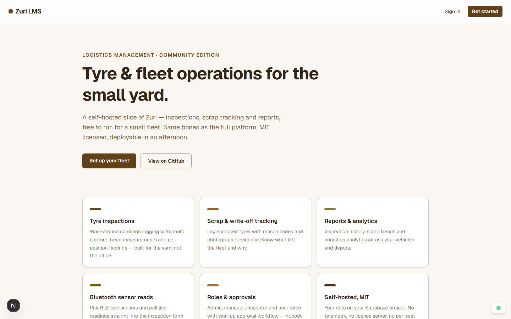
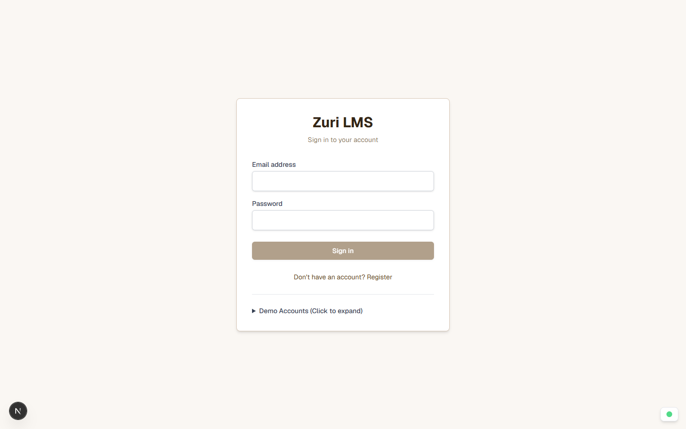
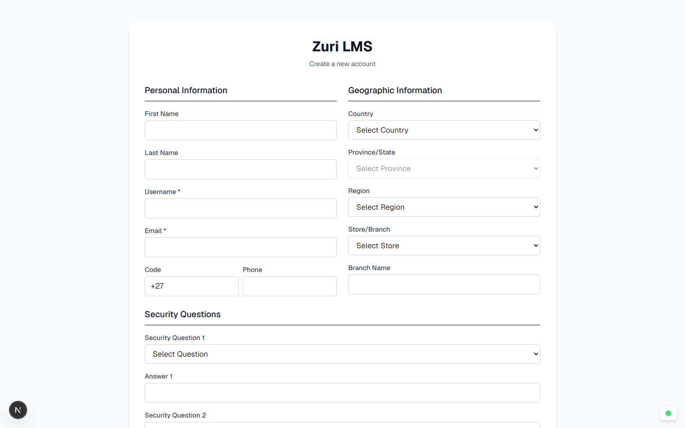

# Zuri LMS — Community Edition

**Open-source tyre inspection and fleet logistics for small fleets — self-hosted, MIT licensed, no telemetry.**

This is a slice of the full Zuri platform: the parts a depot actually needs
day to day, packaged so anyone can clone it, point it at a free Supabase
project, and run it for real. If the mini covers your fleet, you never
needed the rest.

## Screenshots

| Landing | Sign in | Register |
|---|---|---|
|  |  |  |
| Public marketing front | Supabase auth + approval gate | SADC-first geographic profile fields |

> Dashboard, inspections, admin and report screens render once the app is
> pointed at your own Supabase project — they're not screenshotted here
> because no demo backend ships with the repo. `npm run dev` +
> `scripts/create-demo-users.mjs` gets you the full tour in ~10 minutes.

## Features

- **Tyre inspections** — per-position condition logging, photo capture,
  draft auto-save
- **Scrap tracking** — write-offs with reason codes and evidence
- **Reports & analytics** — inspection history, scrap trends, condition
  views per vehicle and depot
- **Roles & approvals** — admin / manager / inspector; sign-ups require
  admin approval; Postgres RLS enforces every table
- **Admin panel** — users, companies, depots, vehicle configs, tyre
  register, data import, activity logs
- **Bluetooth sensors** — Web Bluetooth tyre-sensor reads straight into
  the inspection form (Chrome/Edge)
- **Offline drafts** — inspections survive a dropped connection and sync
  on reconnect
- **Demo mode** — seeded accounts behind `NEXT_PUBLIC_DEMO_MODE`

**Deliberately not here:** multi-tenant org switching, billing, gate
passes, waybills, access control — those live in the commercial platform.
See [docs/ROADMAP.md](docs/ROADMAP.md) for the full shipped-vs-deferred
accounting.

## Stack

Next.js 16 · React 19 · Tailwind CSS 4 · TypeScript strict ·
Supabase (Auth + Postgres + RLS) · Recharts · Web Bluetooth ·
service-worker-free, no tracking anywhere.

## Quickstart

### 1 — Supabase

Create a free project at [supabase.com](https://supabase.com) (or use a
self-hosted Supabase), then apply the schema:

```bash
# easiest: paste supabase/migrations/*.sql in order into the SQL editor,
# or use the Supabase CLI:
supabase db push
# optional demo/reference data (countries, provinces, sample companies):
#   run supabase/seed.sql then supabase/seed_geographic.sql
```

### 2 — App

```bash
npm install
cp .env.example .env.local   # fill in your project URL + keys
npm run dev                  # http://localhost:3000
```

Requires **Node 20.9+** (24 LTS recommended). Constrained box? Next's
build fits comfortably in a few GB — cap Node's heap explicitly if needed:
`NODE_OPTIONS=--max-old-space-size=4096 npm run build`.

### 3 — Demo accounts (optional)

```bash
node scripts/create-demo-users.mjs
```

Sign in at `/login` — the demo hint box appears because
`NEXT_PUBLIC_DEMO_MODE=true` in `.env.example`. Disable it for anything
real.

## Repo layout

```
src/app            # Next.js routes — / landing, /login, /dashboard/*, /admin/*
src/components     # UI + Bluetooth panel
src/contexts       # auth, bluetooth, connection providers
src/lib            # supabase clients, offline sync, crypto
supabase/migrations  # schema, applied in order
supabase/seed*.sql   # reference + demo seed data
scripts/           # demo-user provisioning
docs/              # roadmap, security review
```

## Security model

- Data isolation is **Postgres RLS** — every table has policies; the app
  reads/writes as the signed-in user with their role
- `SUPABASE_SERVICE_ROLE_KEY` is **server-only** (admin API routes +
  the demo-user script). It never ships to the browser
- Sign-ups start `pending` — an admin approves from `/admin/users`
- No secrets in the repo; `.env*` files are gitignored

## License

[MIT](LICENSE) — use it, fork it, ship it.

## Contact

Part of the **[ESO Industries](https://esoind.co.za)** ecosystem.

**Kurt Jonathan** — [esoken92@gmail.com](mailto:esoken92@gmail.com)
